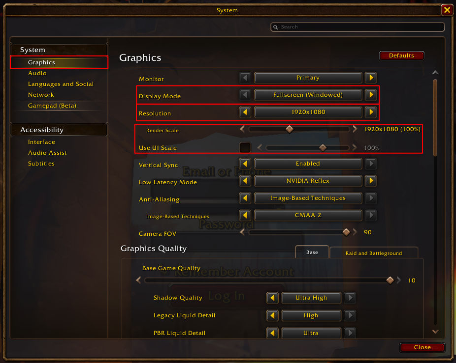

# wow-forever-autocreate

A personal bot that creates World of Warcraft Forever characters at launch, so you don't have to stay awake in the login queue.

You start WoW, leave it in the queue, start the bot and go to bed. The bot waits out the queue, picks your ruleset, and creates the characters from a config file: race, gender, class, appearance, and a list of name pairs to try in order. When the servers push back (faction imbalance, throttling, timeouts, disconnects), it waits and tries again, all night if it has to.

It works by **looking at the screen** (screen capture + OCR) and **clicking like a person** (synthetic mouse and keyboard input). It doesn't read game memory or touch network traffic.

> **English client only.** The bot recognizes screens and error messages by reading their English text. With the game in any other language it can't tell where it is and won't work.
>
> **Exact game settings required** (below). Runs on Linux (Pop!_OS, COSMIC; tested) and Windows 10/11 (new, being tested).

Non-technical setup and launch-night steps are in **[docs/USER_GUIDE.md](docs/USER_GUIDE.md)**.

## Required game settings

All click positions are measured on a 1920×1080 picture of the game, so these settings are **required**, not just recommended:

| Setting (System → Graphics) | Value |
|---|---|
| Display Mode | **Fullscreen (Windowed)** |
| Resolution | **1920x1080** |
| Render Scale | **100%** (shows `1920x1080 (100%)`) |
| Use UI Scale | **off** (box unchecked) |
| Game language (System → Languages and Social) | **English** |



Other graphics options (quality, anti-aliasing, V-Sync…) don't matter.

## What it does

```
Reconnect ─▶ Connecting / Queue / Logging in ─▶ Ruleset select ─▶ Char select
                                                                        │
            ┌──────────────── Create Character ◀────────────────────────┘
            ▼
       Char create ─▶ Customize ─▶ name check ─▶ Finish ─▶ Char select (created)
                          ▲                        │
                          └── error dialog: Okay, wait, check the name again, retry
```

Every frame, the bot first works out **which screen it's on**, then does **one step** for that screen and looks again. So it doesn't matter where you start it, and a disconnect is noticed within a second or two whatever it was doing.

On errors it follows a fixed policy (`states/policy.py`):

| Error | What the bot does |
|---|---|
| Faction imbalance | waits 30–60 s, retries, no limit |
| Throttled / timed out | waits 10 s, 30 s, 60 s…; after 6 in a row, goes back to Reconnect for a fresh session |
| Disconnected / no realms | reconnects after 1, 2, 5, 10, 15 min, then every 15 min, forever |
| Ruleset unavailable | refreshes the ruleset screen every 2 min; after 5 refreshes, reconnects |
| Name taken (red X) | skips that name for good and tries the next one |
| Unknown error | screenshot, waits 60 s, keeps going |
| Character limit reached | stops |

Before every Finish the name is checked again (it may have been taken while the bot was waiting).

## Safety

- **Dry run by default.** `python -m runner` stops right before Finish. Only `--create` creates characters.
- It only ever clicks the buttons it needs. It never clicks Enter World, Delete or Shop.
- It **pauses** whenever WoW loses keyboard focus, so it can't type into another window.
- It stops by itself when it needs a human: character limit, all names rejected, or the login form (it never stores or types your password).
- Every error dialog and every unknown screen is saved to `logs/frames/`, with a log in `logs/run_*.log`.

Automating game input may be against Blizzard's terms of service. Use it at your own risk.

## Quick start (technical)

```bash
sudo apt install tesseract-ocr xdotool
python3 -m venv .venv && source .venv/bin/activate
pip install -r requirements.txt
cp characters.example.yaml characters.yaml     # then edit it
python -m preflight                            # checks everything, clicks nothing
python -m runner                               # dry run
python -m runner --create                      # the real thing
```

## Project layout

```
runner.py              main loop: capture → classify → handler, never crashes overnight
preflight.py           before-run check of the whole setup
states/
  context.py           what the bot remembers (current character, rejected names, backoffs)
  policy.py            what each error means, and every retry/backoff value
  handlers.py          one handler per screen
vision/
  capture/             window capture: python-xlib on XWayland, mss on Windows (win32.py)
  classify.py          which screen is this? (OCR anchors, dialogs first)
  ocr.py               dialog/ruleset OCR; all thresholds and known messages at the top
  detect.py            color detectors: arrows, buttons, checkboxes, name indicator
  layout.yaml          click coordinates at 1920×1080
input/                 mouse/keyboard into the WoW window, focus detection
  xdotool.py           Linux (XWayland)
  win32.py             Windows (SendInput)
config/
  races.yaml           game data: races, classes, appearance options per tab
  models.py            config validation (pydantic)
characters.example.yaml   template for your characters.yaml
scripts/
  slice_orc.py         one character from the char create screen (also the manual fallback)
  list_options.py      lists appearance fields and option counts per race
  grab_fixture.py      saves the current WoW frame as a test fixture
tests/                 pytest; fixtures/ are real 1920×1080 frames
```

## Development

```bash
python -m pytest          # offline: classification, OCR, detectors, state machine
python -m preflight       # live: needs WoW running
```

Tests are driven by **fixture filenames**. A full 1920×1080 frame named after its screen (`char_select_…`, `char_customize_…`, `ruleset_select_…`, `reconnect_…`, `fatal_…`, `logging_in_…`) is automatically a classification test. Hand-cut dialog crops go in `tests/fixtures/approx/` as `error_dialog_<key>_NN.png` or `queue_NN.png`, and are only tested for their text. New screenshots from `logs/frames/` can be renamed and dropped in.

`--create --rehearse-error throttled` on a **full** account treats the "maximum number of characters" popup after Finish as a throttle error, so the whole retry loop can be tested live without creating anything.

## Known gaps

- Only tested live with one character per run: creating several in a row is covered by tests only.
- Faction imbalance, throttling and timeouts have never been seen by the bot live; they're tested through `--rehearse-error` and unit tests.
- First full-frame screenshots of real error dialogs will come from launch night (`logs/frames/`).
