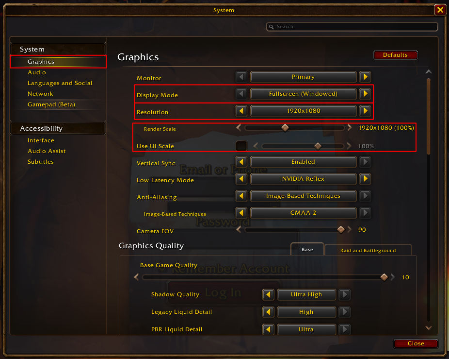

# User guide

This guide walks you through setting up the bot and running it on launch night. You don't need to know Python: copy the commands into a terminal exactly as shown.

**What the bot does:** while you sleep, it waits in the login queue for you, then creates your characters with the race, class, look and name you chose. If the servers are full or a name is taken, it waits, tries again, or moves on to your next name.

**What it needs:** Windows 10/11 or Linux (Pop!_OS), and WoW **in English** with the exact settings from step 2. The bot finds its way by reading the English text on the screen, so it **won't work with the game in any other language**.

---

## 1. One-time setup

### On Windows

1. **Python:** download it from [python.org](https://www.python.org/downloads/) (3.12 or newer). In the installer, tick **"Add python.exe to PATH"** before clicking Install.
2. **Tesseract** (reads the text on the screen): download the Windows installer from the [UB Mannheim page](https://github.com/UB-Mannheim/tesseract/wiki) and install it to the **default folder**. The bot finds it there by itself.
3. Open **Command Prompt** (press the Windows key, type `cmd`, Enter). Use Command Prompt, not PowerShell. Go to the bot's folder, for example:

   ```bat
   cd %USERPROFILE%\Downloads\wow-forever-autocreate
   ```

4. Create a private Python environment for the bot and install what it needs:

   ```bat
   python -m venv .venv
   .venv\Scripts\activate
   pip install -r requirements.txt
   ```

> **Every time you open a new Command Prompt** for the bot, go to the folder and run `.venv\Scripts\activate` again. You'll see `(.venv)` at the start of the line when it's active.

In the rest of this guide, commands are the same on Windows, except `cp` (Linux) is `copy` on Windows.

### On Linux

Open a terminal (search for "Terminal" in the apps). Go to the bot's folder, for example:

```bash
cd ~/Documents/scripts/wow-forever-autocreate
```

Install the two programs the bot uses (one reads text on the screen, one moves the mouse). It will ask for your password:

```bash
sudo apt install tesseract-ocr xdotool
```

Create a private Python environment for the bot and install what it needs:

```bash
python3 -m venv .venv
source .venv/bin/activate
pip install -r requirements.txt
```

> **Every time you open a new terminal** for the bot, first go to the folder and run `source .venv/bin/activate` again. You'll see `(.venv)` at the start of the line when it's active.

## 2. Game settings (required)

The bot clicks at exact spots on the screen, so these settings **must** match. Open the game menu, go to **System → Graphics** and set:

- **Display Mode:** Fullscreen (Windowed)
- **Resolution:** 1920x1080
- **Render Scale:** 100% (the text next to the slider says `1920x1080 (100%)`)
- **Use UI Scale:** off (the box is empty)



Then, under **System → Languages and Social**, make sure the game language is **English**.

Nothing else in the graphics settings matters.

**Monitor bigger than 1920×1080?** In "Fullscreen (Windowed)" the game takes the size of your desktop, whatever the Resolution setting says. For launch night, set the desktop itself to 1920×1080: on Windows, **Settings → System → Display → Display resolution**. Windows display scaling (100%, 125%…) doesn't matter.

## 3. Your characters

Make your own copy of the example file:

```bash
cp characters.example.yaml characters.yaml
```

Open `characters.yaml` in a text editor. It looks like this:

```yaml
ruleset: pvp            # normal, pvp, roleplay or roleplay_pvp
has_pack: false         # true if you bought the Skyborne pack

characters:
  - race: undead
    gender: female
    class: priest
    hd_model: true      # true = HD models, false = classic look
    appearance: random  # or choose each option, see below
    names:              # tried from top to bottom
      - { main: Mira, secondary: Ashveil }
      - { main: Mira, secondary: Duskveil }
```

- **Names:** list several, best first. If one is taken (red X in the game), the bot uses the next one. Each part must be 2–12 letters, and no letter three times in a row.
- **Appearance:** `random` rolls the dice once. To choose each option instead, see which options exist for your race:

  ```bash
  python -m scripts.list_options undead female
  ```

  It prints something like `skin_color (1-10), face (1-14), hair_style (1-12) …`. Use those names and numbers, counting from 1 as in the game:

  ```yaml
      appearance:
        skin_color: 5
        hair_style: 4
  ```

  Options you leave out stay at the game's default.
- **Several characters:** add another block starting with `- race:` under `characters:`. They're created in order. You need a free character slot for each.

## 4. Check your setup

Start WoW (fullscreen), then run:

```bash
python -m preflight
```

It checks everything one by one and **never clicks anything**. Each line says `OK`, `WARN` or `FAIL`. Near the end it asks you to click into the WoW window. Fix every `FAIL`: the message tells you how. `WARN` lines are usually fine, but read them.

It also saves what the bot sees as `logs/preflight_frame.png`. Open it and check it shows your game.

## 5. Practice run

The practice run does everything **except** the final Finish click, so nothing is created:

```bash
python -m runner
```

Then **click into an empty spot of the WoW window** (sky or background, not a button). The bot starts as soon as WoW has focus. Don't touch the mouse or keyboard while it works. It ends with:

```
DRY RUN: name ... accepted, Finish active. Stopping before Finish.
```

If you get that line, you're ready for launch night.

## 6. Launch night

1. Make sure you have a **free character slot**, and the game settings from step 2 are still set.
2. Turn off the screen lock / sleep and notifications (Do Not Disturb; on Windows also set **Settings → System → Power → Screen and sleep** to Never). Close the Steam overlay.
3. Start WoW from the launcher. It's fine to start the bot while WoW is still in the login queue.
4. In the terminal:

   ```bash
   source .venv/bin/activate
   python -m runner --create
   ```

5. Click into an empty spot of the WoW window. Leave the computer alone.

The bot keeps going on its own through queues, errors and disconnects. In the morning, look at the end of the log in `logs/` (the newest `run_….log` file). `CREATED` lines show what was made.

To stop the bot at any time: click into the terminal and press **Ctrl+C**.

## 7. Reading the log

| You see | It means |
|---|---|
| `== QUEUE` / `queue position …` | waiting in the login queue, all fine |
| `ruleset 'PvP' unavailable, refresh in …` | that ruleset is closed for now; the bot keeps checking |
| `name rejected` | that name is taken; trying your next one |
| `error dialog: faction_imbalance` | too many players of your faction; it waits and retries |
| `error dialog: throttled` / `timed_out` | servers are busy; it waits longer each time |
| `Reconnect in … s` | it was disconnected and will reconnect by itself |
| `WoW lost focus: paused` | another window got in front; click into WoW to continue |
| `CREATED …` | a character was made |
| `all names rejected` | every name in your list is taken: add more names and start again |
| `stopped: needs a human` | read the lines just above it |

## 8. If something goes wrong

- **"no usable WoW window"**: WoW isn't running, or the settings from step 2 aren't set (Fullscreen (Windowed), 1920x1080).
- **It keeps saying `unknown screen`**: check that the game is in English and Render Scale is 100%, UI Scale off (step 2).
- **The bot does nothing after starting**: it's waiting for you to click into WoW. Click an empty spot in the game.
- **"login form"**: WoW logged you out completely. Log in by hand, then start the bot again.
- **It stops with "character limit"**: free a character slot.
- **Anything else**: send the newest `logs/run_….log` file and the pictures in `logs/frames/` to whoever gave you the bot.

**Backup plan:** if the bot can't get through, get to the character creation screen by hand, then run `python -m scripts.slice_orc --config characters.yaml --create`. It creates the first character from your file starting from that screen.
